<p align="center">
  <picture>
    <source media="(prefers-color-scheme: dark)" srcset="https://raw.githubusercontent.com/genbs/reactive-leds/master/cli/ui/logo-white.svg">
    <source media="(prefers-color-scheme: light)" srcset="https://raw.githubusercontent.com/genbs/reactive-leds/master/cli/ui/logo-black.svg">
    
  </picture>
</p>

[](https://github.com/genbs/reactive-leds/actions/workflows/firmware-build.yml)
[](https://github.com/genbs/reactive-leds/actions/workflows/test-shared.yml)
[](https://github.com/genbs/reactive-leds/actions/workflows/test-cli.yml)
[](https://github.com/genbs/reactive-leds/actions/workflows/test-client.yml)
[](https://www.gnu.org/licenses/gpl-3.0)
[](https://github.com/genbs/reactive-leds/commits/master)

# Welcome to Reactive-LEDS

Language: [English](https://github.com/genbs/reactive-leds/blob/master/README.md) | [Italiano](https://github.com/genbs/reactive-leds/blob/master/README-it.md)

<p align="center">
  
</p>

## Introduction

This project documents my personal experience building a 3D-printed LED tube, controllable over WiFi.

It was born out of a personal need: I wanted lights for my live coding performances, and as a software developer with a 3D printer I had fun building a system that lets me control lights from the browser with minimal latency at a reasonable cost.

The firmware and the 3D models are designed around the hardware I used. Take them as a starting point and adapt them to your own setup.

## Result

The current build is a 1-meter tube with a 24V FCOB strip, driven by an ESP32-S3 microcontroller, all powered by a 24V supply and controllable over WebSocket or UDP.
You can build as many strips as you want — just connect them to the same network.

## How it works

The complete flow:

```
browser
  → WebSocket → CLI proxy (ws)
    → UDP → ESP32-S3
      → RMT peripheral
        → LED strip
```

Browsers cannot send UDP directly, so the CLI exposes a local WebSocket proxy that bridges to the device. The ESP32 receives the UDP packets and updates the strip through the RMT peripheral, which generates the signal in hardware without involving the CPU.

The first time, the device is configured over USB from the site or the CLI, or over BLE with the CLI. After rebooting, it joins the network and is ready to receive commands.

## WLED compatibility

I started developing the firmware out of curiosity and to have full control over the realtime path. Only later did I take a closer look at [WLED](https://kno.wled.ge/), which supports UDP control through DDP.

In tests with ESP32-S3 boards and 16 segments, WLED and reactive-leds were equally smooth at 60 fps. With 90 and 120 fps streams, stock WLED coalesced updates and rendered about 62 frames per second, while the included firmware rendered every frame without drops. For normal browser use at 60 fps, this difference is not significant.

WLED is not currently supported. If you would like to use it with reactive-leds, open a GitHub issue or submit a pull request.

## Repository layout

This is a small monorepo. Each main area has its own folder and its own README.

- [`firmware/`](https://github.com/genbs/reactive-leds/tree/master/firmware): ESP32-S3 firmware and build instructions.
- [`cli/`](https://github.com/genbs/reactive-leds/tree/master/cli): CLI tools and scripts to configure and test the devices and to start the WebSocket control server.
- [`client/`](https://github.com/genbs/reactive-leds/tree/master/client): JavaScript client for real-time control from the browser.
- [`shared/`](https://github.com/genbs/reactive-leds/tree/master/shared): Protocol and shared types used across packages.
- [`3dprint/`](https://github.com/genbs/reactive-leds/tree/master/3dprint): STL models and CAD sources for the enclosure and the LED rail.
- [`docs/`](https://github.com/genbs/reactive-leds/tree/master/docs): the [project site](https://genbs.github.io/reactive-leds/) (GitHub Pages): guided install (CLI + firmware flashing from the browser via Web Serial), live examples and the strip mapping tool.

## Getting started

- Build/flash the firmware: see [`firmware/README.md`](https://github.com/genbs/reactive-leds/blob/master/firmware/README.md).
- CLI tools for testing: see [`cli/README.md`](https://github.com/genbs/reactive-leds/blob/master/cli/README.md).
- Using the JavaScript client: see [`client/README.md`](https://github.com/genbs/reactive-leds/blob/master/client/README.md).
- Protocol/types: see [`shared/README.md`](https://github.com/genbs/reactive-leds/blob/master/shared/README.md).

## Materials

- [24V FCOB LED strip](https://it.aliexpress.com/item/1005007316659176.html)
- [XL4015 DC-DC module (24V → 5V)](https://it.aliexpress.com/item/1005008231627584.html)
- [ESP32-S3](https://it.aliexpress.com/item/1005005045724400.html)
- [24V power supply](https://www.amazon.it/dp/B0C8CM7GS7)
- [Power cable](https://it.aliexpress.com/item/1005007046323657.html)
- [JST](https://it.aliexpress.com/item/1005005362711029.html) ([alternative](https://it.aliexpress.com/item/1005004615616698.html)) pick the 3-pin variant (VCC, GND, DATA)
- 330 Ω resistor in series on the LED data line

These are the materials I used, but the project adapts to similar strips and components. Just make sure to configure the firmware for your strip (color order, number of segments, etc.). ESP32-S3 modules with PSRAM are fine, but PSRAM is not required for this use case: the realtime LED path uses small buffers in internal RAM.

If I were to improve the build, I would replace the somewhat fragile JST connectors and add a way to support the solder joint at the start of the LED strip.

## 3D printing

The models and settings are only a starting point — I am not a 3D printing expert.
The enclosure is designed to house the ESP32-S3 and the DC-DC module listed above, together with a 12mm LED strip rail.

For the rail I printed five 20 cm PLA pieces: either five `profile` pieces, or four `profile` pieces plus the optional `profile_head`. For the diffuser I used four 25 cm pieces of transparent PETG.

1. Print the enclosure parts (`case/*.stl`) and the LED rail (`tube/*.stl`); see [`3dprint/README.md`](https://github.com/genbs/reactive-leds/blob/master/3dprint/README.md) for materials and settings.
2. Get the microcontroller, DC-DC module, power cable, JST pins, 330 Ω resistor and LED strip.
3. Assemble everything by following the photos and instructions below.
4. Flash the firmware from the [project site](https://genbs.github.io/reactive-leds/) or see [`firmware/README.md`](https://github.com/genbs/reactive-leds/blob/master/firmware/README.md), and configure WiFi over USB or BLE with the [CLI](https://github.com/genbs/reactive-leds/blob/master/cli/README.md).

<table>
  <tr>
    <td align="center" valign="top">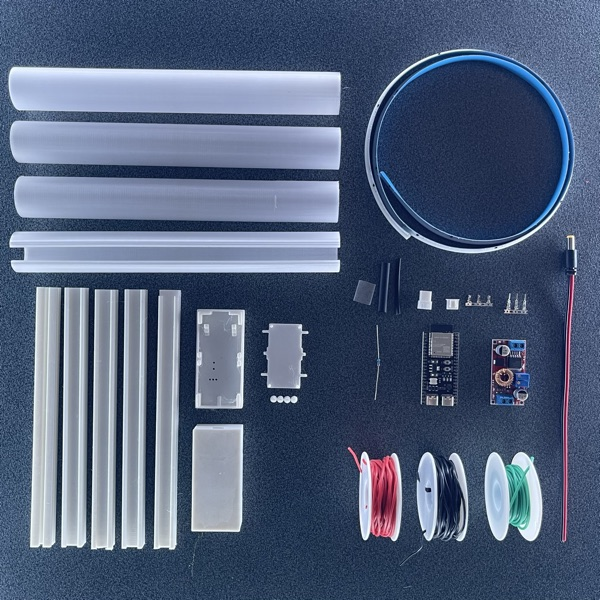<br><sub>1. Component overview</sub></td>
    <td align="center" valign="top">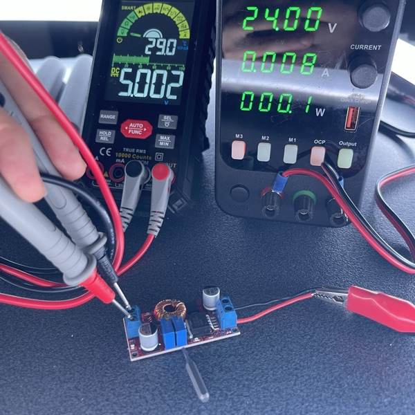<br><sub>2. Step down the DC-DC module voltage from 24V to 5V</sub></td>
    <td align="center" valign="top">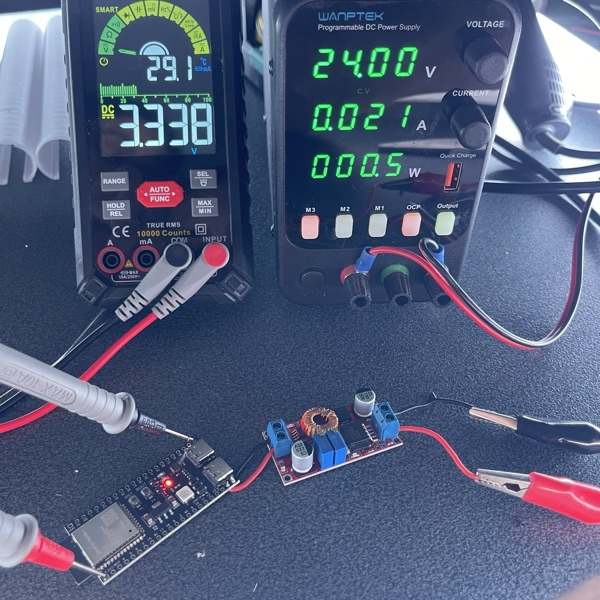<br><sub>3. Solder the DC-DC module output to the microcontroller and check that the pins output 3.3V</sub></td>
  </tr>
  <tr>
    <td align="center" valign="top">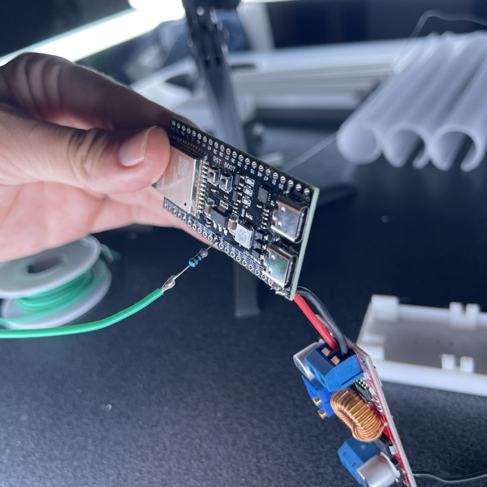<br><sub>4. Solder the resistor to pin 18 (configurable via firmware)</sub></td>
    <td align="center" valign="top">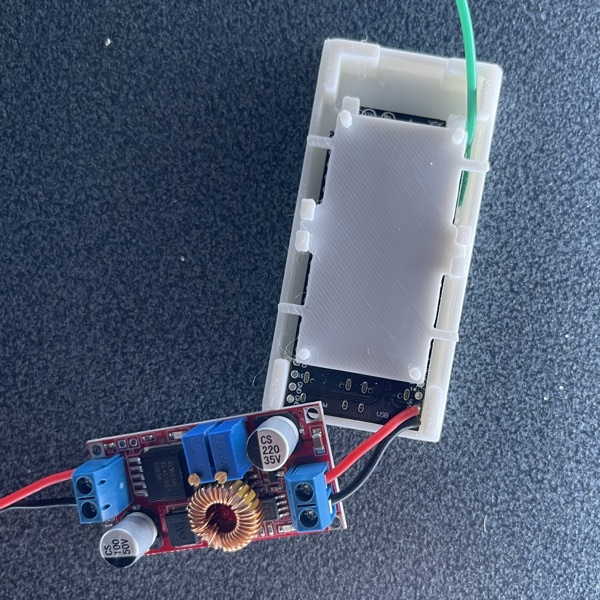<br><sub>5. Insert the microcontroller into the enclosure, making sure to keep the resistor at the bottom, and position the DC-DC module compartment</sub></td>
    <td align="center" valign="top">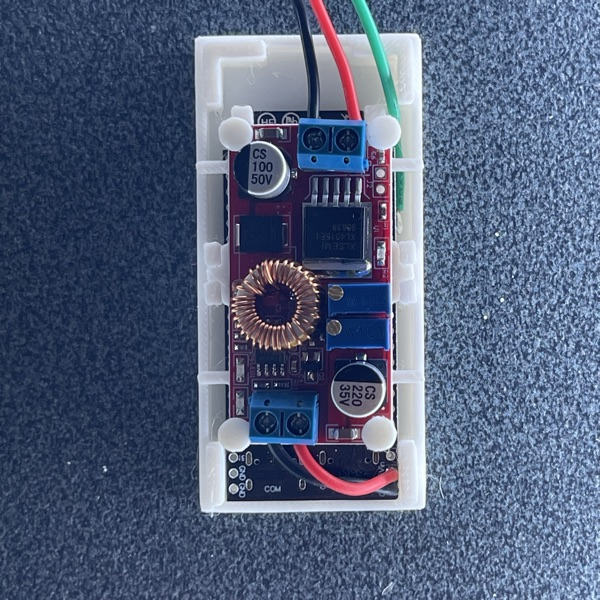<br><sub>6. Once the DC-DC module is in place, you can glue the enclosure caps</sub></td>
  </tr>
  <tr>
    <td align="center" valign="top">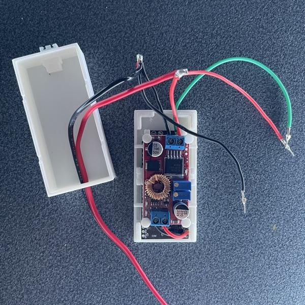<br><sub>7. Insert the power cable into the other part of the enclosure, glue the JST connector and crimp the male pins onto the cables</sub></td>
    <td align="center" valign="top">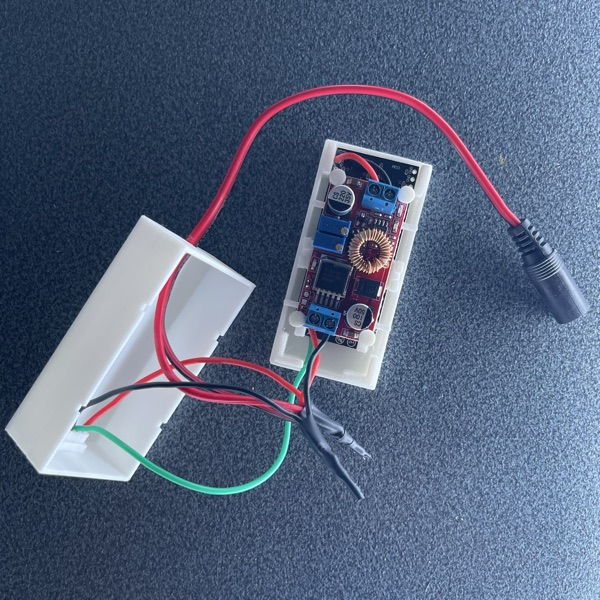<br><sub>8. Use heat-shrink tubing to insulate the cables and insert the pins into the connector</sub></td>
    <td align="center" valign="top">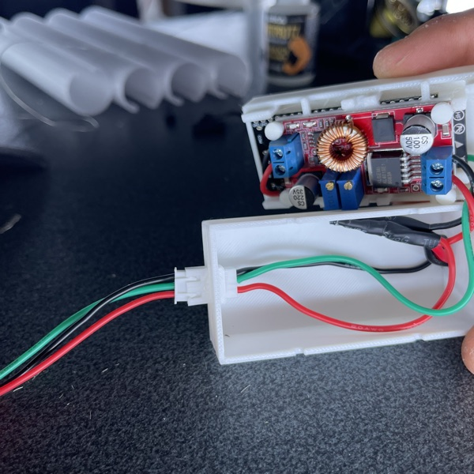<br><sub>9. Check that the male and female JST connectors match</sub></td>
  </tr>
  <tr>
    <td align="center" valign="top">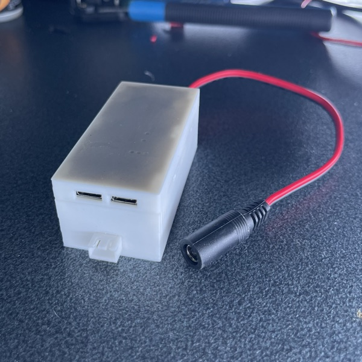<br><sub>10. You can now close the enclosure</sub></td>
    <td align="center" valign="top">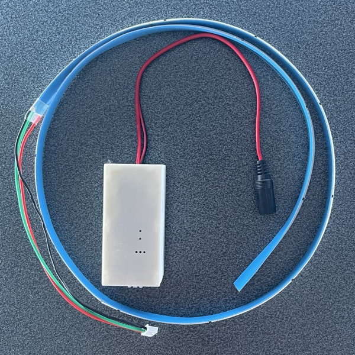<br><sub>11. Overview of the enclosure with the LED strip</sub></td>
    <td align="center" valign="top">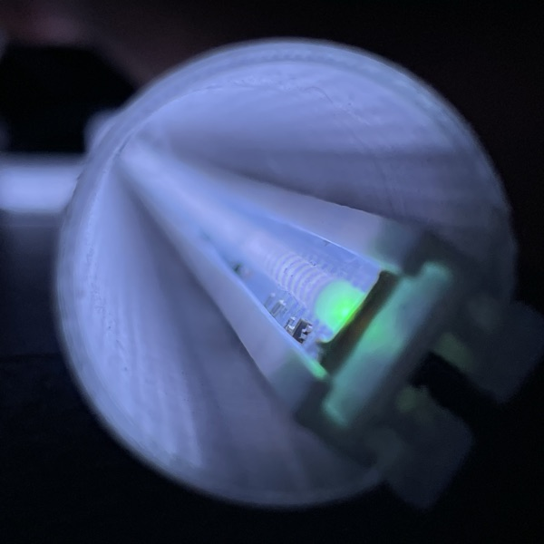<br><sub>12. After gluing the rail with the diffuser, you can insert the LED strip</sub></td>
  </tr>
</table>

## Transporting the tubes

At first I carried them in a cloth wrap with elastic bands, like a roll-up pencil case, but I did not feel they were secure enough.
I later built a wooden case based on this [tutorial](https://www.youtube.com/watch?v=2dAB4Z64CAM) and printed PLA parts to hold the LED tubes inside it. The case fits 12 tubes.

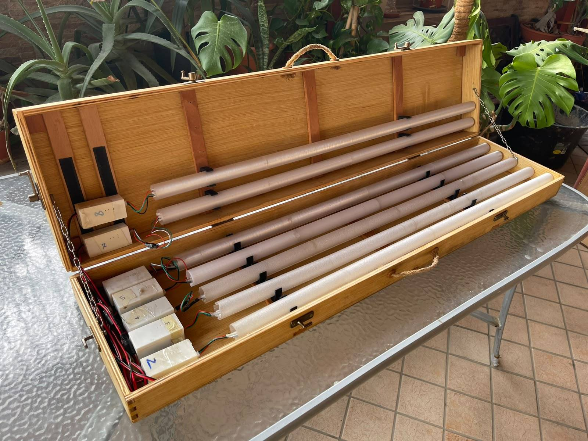

## Limitations and known issues

- **Segment-level control, not per-LED**: the FCOB strip has 896 LEDs per meter but only 16 ICs per meter. Control happens per segment (16 segments/m), not per individual LED. This is a deliberate choice: I preferred a brighter strip over resolution.
- **255 LEDs per device**: `num_leds` and `start_index` are single bytes in the UDP protocol. More than enough for segment strips (~15 m of FCOB per device); it is not designed for high-density matrix panels.
- **Color order**: the RGB/WRGB byte sequence depends on the strip's IC. The firmware is configured for the strip listed in Materials. Different strips may need a different order (see `firmware/main/leds.c`).
- **WiFi sleep disabled**: the WiFi radio power-saving mode is explicitly disabled to avoid latency spikes and packet loss during real-time updates.
- **WiFi credentials in cleartext over BLE**: during provisioning the credentials are sent unencrypted. For a personal project simplicity wins, but keep it in mind on sensitive networks.

## Power and safety

The LED strip runs at 24V. Power supply sizing depends on the strip's specs and the real load — as a reference, with all LEDs on the strip draws roughly **1 A per meter**. Use a supply with adequate headroom and proper wiring.

## License

The firmware and CLI are licensed under GPL-3.0-only. The `client` and `shared` packages are licensed under MIT; see the `LICENSE` file in each directory for the full terms.
